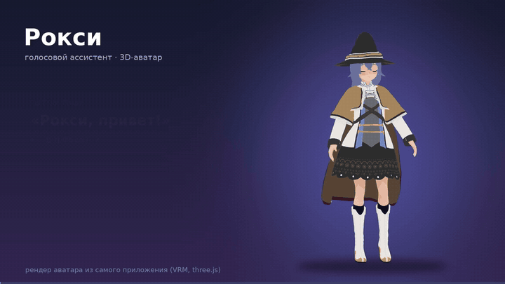

# Рокси — голосовой ассистент с 3D-аватаром

Голосовой помощник для Windows: слушает слово «Рокси», понимает команды (открыть программу, окно, файл,
таймер, погода, музыка, Telegram, код), отвечает голосом и живёт на рабочем столе 3D-аватаром (VRM) в прозрачном окне:
гуляет, колдует посохом, играет с окнами и танцует под музыку. Её можно перебить голосом.

[](docs/roxy_demo.mp4)

**[▶ Полное видео (41 с)](docs/roxy_demo.mp4)** — первые сцены записаны в самом приложении, блок «Управление с телефона» — иллюстрация-макет, а не запись экрана.

*Аватар на демо — пользовательская VRM-модель, в репозиторий она не входит: положи свою VRM в `live2d_assets/models/`.*

> **English summary.** Roxy is a Russian-language voice assistant for Windows, written in Python. It listens for the wake word,
> understands spoken commands (open apps, manage windows and files, timers, weather, music, screen reading) and answers by voice.
> A 3D VRM avatar lives on the desktop in a transparent window, and the PC can be controlled remotely from a phone via Telegram.
> **Stack:** Vosk (wake word), faster-whisper (speech recognition), Piper / RVC (TTS), OpenRouter and Groq (LLM), Tesseract OCR,
> three.js + three-vrm, Telethon. **Safety:** confirmation before dangerous actions, protected system folders, localhost-only
> avatar window, secrets kept in `.env` and masked in logs, an automated test that checks the code for leaked secrets.
> Models and voices are not included (see Quick start); Windows only.

## Быстрый старт

1. Python-окружение и пакеты:
   ```
   python -m venv .venv
   .venv\Scripts\activate
   python -m pip install -r requirements.txt
   ```
2. **Ключи.** Скопируй `.env.example` в `.env` и впиши свои значения (файл `.env` в `.gitignore` и никуда не уходит):
   ```
   OPENROUTER_API_KEY=...
   GROQ_API_KEY=...
   TG_API_ID=...        # только если нужен Telegram
   TG_API_HASH=...
   ```
3. **Модели** (в репозиторий не входят — лежат рядом с проектом):
   | Что | Папка | Откуда (например) |
   |---|---|---|
   | голос Piper | `piper_voice/ru_RU-irina-medium.onnx` | rhasspy/piper-voices на Hugging Face |
   | Whisper (faster-whisper) | `whisper_medium_model/` | Systran/faster-whisper-medium на Hugging Face |
   | Vosk (слово «Рокси») | `vosk_model_ru/` | alphacephei.com/vosk/models |
   | аватар | `live2d_assets/models/*.vrm` | твоя VRM-модель (берётся самая новая) |
   Также нужны Tesseract OCR (путь в `settings.py`: `TESSERACT_PATH`) и, для «аниме-голоса», отдельная папка `rvc_tool`
   с `rvc-next` (путь можно задать в `.env`: `ROXY_RVC_EXE`).
4. Один раз: `python setup_vrm.py` — скачает three.js и three-vrm для 3D-аватара.
5. Telegram (по желанию): `python telegram_auth.py` — один раз войти по коду, появится `roxy_session.session`.
6. **Запуск — через лаунчер:** двойной клик по `roxy_app.bat` (или `python roxy_launcher.py`). Кнопка «Разбудить Рокси»,
   дальше скажи «Рокси» и команду. Без лаунчера: `python main.py` или `start_roxy.bat`.
   В трее есть значок «Р»: спрятать/показать, брать мышкой, одежда, прогулки, выключить.

## Перенос на второй свой компьютер
1. На этом ПК: `.venv\Scripts\python.exe pack_roxy.py` — на рабочем столе появится `Roxy_transfer_<дата>.zip`
   (проект, модели, аниме-голос из `%USERPROFILE%\rvc_tool` и точные версии пакетов; без `.env` и сессии Telegram).
2. На втором ПК: распакуй (лучше в путь без русских букв, например `C:\Roxy`) и запусти `Roxy\install_roxy.bat`.
   Он поставит Python той же версии (через winget), окружение, пакеты, аниме-голос, Tesseract и ярлык «Рокси».
3. Скопируй `.env` со старого ПК (или заполни заново по `.env.example`).
Архив — только для своих компьютеров: модель с Booth и голос раздавать нельзя.

## Управление с телефона (Telegram)
**Основной способ — через твой аккаунт** (нужна сессия Telegram, как для отправки сообщений голосом).
Пиши своему боту с телефона (`tg_remote_chat` в `config.json`, по умолчанию `RoxyAIAssistant_bot`; можно `"me"` —
«Избранное»). Рокси читает только ТВОИ сообщения в этом одном чате, выполняет и отвечает туда же строкой «🤖 …».
Bot API при этом не используется — работает, даже если `api.telegram.org` отвечает 429.

Что можно с телефона (полный список — `/help` в чате):
- **Мышь**: «передвинь на 300 вправо», «кликни», «нажми ПКМ», «двойной клик», «прокрути вниз»,
  «зажми левую» → двигаешь → «отпусти» (перетаскивание; зажатую кнопку она сама отпустит через 2 минуты).
- **Сетка**: `/grid` — снимок экрана с клетками А1…Т9 и красным кольцом на курсоре. Дальше «Б4», «кликни Б4»,
  «нажми правой в Б4». После каждой команды мышью или клавишами снимок с сеткой приходит сам
  (`tg_screen_after_mouse`).
- **Клавиши**: «нажми Enter», «Ctrl+C», «нажми Alt Tab», «нажми F5», «нажми стрелку вниз 3 раза».
- **Текст и буфер**: «напиши привет» (туда, где курсор), «положи в буфер: текст», «что в буфере».
- **Файлы**: «пришли файл отчёт.docx» (ищет на рабочем столе, в Документах, Загрузках и открытой папке);
  `.env`, сессии Telegram, `config.json` Рокси, ключи и папка `.ssh` не отправляются никогда.
  Файл или фото, присланные в чат, сохраняются в «Загрузки».
- **Компьютер**: «как дела у компа» (процессор, память, диск, батарея), «что запущено», «заверши хром»
  (после «да»), «заблокируй», «переведи в сон» (после «да»; разбудить с телефона потом нельзя).
- Таймеры и напоминания дублируются сообщением в чат (`tg_notify_timers`).
- Голосом тоже можно: «пришли скриншот на телефон», «скинь файл отчёт.docx».

**Запасной способ — Bot API** (включается, только если первый не завёлся):
1. Создай бота у @BotFather, токен впиши в `.env`: `TG_BOT_TOKEN=...`
2. Перезапусти Рокси — в журнале появится строка «Чтобы привязать телефон, отправь боту: /start 123456».
   Отправь это боту — он запомнит тебя (`tg_bot_owner` в `config.json`), остальным отвечать не будет.
3. Пиши боту как Рокси голосом: «выключи компьютер через час», «громкость 30», «поставь таймер на 10 минут»,
   «что за ошибка на экране». Ответ приходит в чат (вслух на компьютере она в это время не говорит).
   Опасное спрашивает «да/нет» прямо в чате. `/screen` — снимок экрана, `/unlink` — отвязать телефон.

## Лаунчер (`roxy_app.bat`)
Окно с её аватаркой, где всё настраивается без правки `config.json`:
- **Включить / выключить** одной кнопкой; статус («Просыпается…», «Работает»). Выключает мягко, с уборкой.
- **Написать Рокси** — поле прямо в окне: написанное выполняется как сказанное голосом (Enter — отправить).
- **Голос:** аниме-голос (RVC) или быстрый (Piper); **громкость её голоса** (0–150 %, меняется сразу, общую громкость Windows не трогает);
  **пауза перед ответом** (0,7–3 с тишины — «договорил»; меняется сразу);
  **выбор микрофона** (применяется после перезапуска; если микрофон отключён — берёт системный).
- **Тумблеры:** перебивание голосом, вопрос перед опасным, умное понимание команд, «живёт сама», танцы под музыку,
  тени, держать голос и распознавание загруженными, снимок после команд с телефона, таймеры на телефон,
  скриншоты в облако.
  Что требует перезапуска, лаунчер подскажет плашкой с кнопкой «Перезапустить».
- **Система:** запуск вместе с Windows (лаунчер сам включит Рокси и спрячется в трей), ярлык на рабочий стол, папка журналов.
- **Журнал** — вывод Рокси; ошибки самого лаунчера — в `logs/launcher.log`.
- Закрытие окна прячет его в трей; повторный запуск открывает уже запущенный лаунчер.

## Что умеет
- Окна и программы: «открой блокнот», «сверни все окна», «разверни окно», «закрой вкладку», «переименуй в …».
- Файлы: «создай файл …» (существующий не затирает), «удали файл …» (в Корзину, после «да»).
- Время и дата: «который час», «какое сегодня число». Погода: «погода в Москве», «погода завтра в Казани».
- Таймеры и напоминания (переживают перезапуск): «поставь таймер на 5 минут», «напомни через 10 минут …».
- Telegram: «прочитай телеграм Вася», «напиши в телеграм @user привет», «ответь Васе …» (отправка — только после «да»).
- Экран: «глянь на экран», «прокомментируй экран», «что за ошибка» (окно уходит в облачную нейросеть — по умолчанию спросит).
- Компьютер: «выключи компьютер», «выключи комп через 30 минут / через час / в 23:30», «перезагрузи компьютер», «отмени выключение» (всегда переспрашивает).
- Печать: «напиши привет» — в активное окно, туда, где курсор; «напиши в блокнот привет» — в Блокнот.
- Мышь: «перенеси мышку на 100 пикселей вниз», «курсор в центр / в левый верхний угол», «курсор в Б4» (сетка), «кликни», «нажми ПКМ / ЛКМ / колёсико», «нажми левой кнопкой мыши», «кликни правой два раза», «прокрути вниз».
- Клавиши: «нажми Enter», «нажми Ctrl+C», «нажми Alt Tab», «нажми стрелку вниз 3 раза».
- Компьютер: «как дела у компа», «что запущено», «заверши хром», «заблокируй», «переведи в сон».
- Яркость: «яркость 50», «сделай ярче», «темнее на 20», «какая яркость» (нужен пакет `screen-brightness-control`).
- Музыка и громкость: «громкость 30», «чуть громче», «намного тише», «выключи звук», «пауза», «следующий трек»,
  «какая сейчас громкость», «что сейчас играет» (Spotify, YouTube, Яндекс Музыка, VK).
- Японский и китайский в ответах она читает вслух по-русски (東京 → «Токё», 你好 → «ни хао»), нужны пакеты `pykakasi` и `pypinyin`.
- Vision-агент, код, чтение библиотеки.
- **Перебить:** просто заговори, пока она отвечает (тумблер «Перебивание голосом»), — замолчит и выслушает;
  или **Num Lock / Pause**. «Рокси, стоп» (или «выключись») — выключить её.
- Написать вместо голоса: поле в лаунчере, двойной клик по Рокси или **Num +**.

### Команды аватару
| Что | Скажи |
|---|---|
| движение | «иди сюда», «погуляй», «прыгни», «покрутись», «сядь на окно», «слезь», «обопрись», «стой на месте» / «гуляй сама» |
| жесты | «поклонись», «потянись», «зевни», «оглянись», «кивни», «помотай головой» |
| танец | «потанцуй» — просто танец; «потанцуй под музыку», «станцуй под эту песню» — в ритм играющей музыки; «хватит танцевать» |
| магия | «наколдуй водный шар», «наколдуй лёд» / «заморозь», «вызови дождик», «сделай фонтан», «покажи магию» |
| посох | «достань посох» / «обопрись на посох», «покрути посох» |
| трюки | «сделай сальто», «сделай колесо» / «пройдись колесом», «встань на руки» (изредка делает и сама) |
| окна | «выгляни» (из-за края окна), «спрячься» / «поиграем в прятки», «толкни окно» (двигает его ладонями) |

## Аватар
- Живые позы стоя (вес на одну ногу, нога за ногу, рука на бедре, руки спереди/за спиной), сама меняет их.
- Иногда опирается о край экрана («обопрись»). Ночью, если долго тихо, дремлет; будят голос, мышь, команды.
- Погладь курсором по голове — жмурится; ткни в голову — потирает макушку; в живот — дуется.
- Пока говорит — губы по звукам (А/И/У/Э/О), жесты руками, кивки; тело показывает эмоцию.
- Ткань (плащ, юбка, волосы) и мягкая шляпа реагируют на ходьбу, прыжки и перетаскивание; ткань огибает руки.
- Когда печатаешь — поглядывает на окно, в котором ты пишешь.
- **Магия:** посох с водным камнем; заклинания — водный шар, ледяные кристаллы, дождик из тучки, фонтан; сама иногда
  достаёт посох, опирается на него или крутит в ладони. Если в прыжке задела шляпу и та упала — нагнётся и подберёт.
- **Трюки:** сальто назад, колесо, стойка на руках (юбка и плащ вниз головой свисают к голове).
- **Игра с окнами:** выглядывает из-за края окна, прячется за ним и толкает окна ладонями.
- **Танец под музыку:** Рокси слышит, что играет в Windows (по общему уровню звука, без записи), определяет темп
  и танцует в такт: покачивание, руки у груди, взмахи над головой. Сама пускается в пляс изредка и ненадолго,
  по команде — пока играет музыка. Музыка кончилась, команда, клик по ней — останавливается.

## Настройки (`config.json`, создаётся сам)
| Ключ | По умолчанию | Что делает |
|---|---|---|
| `voice_mode` | `anime` | `anime` (RVC) или `fast` (Piper) |
| `confirm_dangerous` | `true` | спрашивать «да/нет» перед удалением, закрытием окон и т.п. Telegram-отправки и отправка экрана в облако спрашивают всегда |
| `send_screenshots_to_cloud` | `false` | `true` — не спрашивать перед отправкой окна в облачную нейросеть при поиске файла «на глаз» |
| `vision_allow_system_apps` | `false` | `true` — разрешить Vision-агенту работать в консоли, PowerShell, диспетчере задач |
| `use_llm_router` | `true` | LLM-роутер для фраз, которые не поймали регулярки |
| `rvc_worker`, `preload_whisper` | `true` | фоновый RVC и прогрев Whisper |
| `pet_autonomy` | `true` | аватар сама гуляет, прыгает и садится на окна |
| `barge_in` | `true` | перебивание голосом: заговорил во время ответа — замолкает |
| `music_dance` | `true` | сама иногда танцует, когда играет музыка (по команде танцует в любом случае) |
| `voice_volume` | `1.0` | громкость её голоса, 0…1.5; меняется на лету |
| `mic_device` | `""` | имя микрофона; пусто — системный по умолчанию |
| `end_silence` | `1.3` | сколько секунд тишины считать концом фразы (было 3 с); меньше — быстрее отвечает, но может перебить на паузе |
| `tg_remote_chat` | `RoxyAIAssistant_bot` | чат для управления с телефона (имя бота без @ или `me` — «Избранное») |
| `tg_screen_after_mouse` | `true` | после команды мышью/клавишами с телефона присылать снимок с сеткой |
| `tg_notify_timers` | `true` | таймеры и напоминания дублировать сообщением на телефон |
| `live2d_shadows` | `true` | тени на одежде и на полу |
| `live2d_height` | `600` | размер аватара |
| `live2d_fps` | `0` | ограничение кадров (например `40`), 0 — без ограничения |
| `avatar`, `vrm_model` | `auto` | `auto`/`vrm`/`live2d`; конкретный VRM-файл |
| `live2d_direct_composition` | `false` | `true` — вернуть аппаратную композицию Chromium (выключена против мигания) |
| `live2d_posetest` | `false` | отладка: все позы стоя по очереди каждые 6 с |

## Безопасность
- Удалённое управление с телефона принимает команды только из твоих собственных исходящих сообщений в одном выбранном чате (`tg_remote_chat`). Поэтому файл сессии `roxy_session.session` равен доступу к твоему аккаунту и компьютеру: не коммить его, не копируй и никому не отдавай. Если он утёк, завершить сессию можно в Telegram: Настройки → Устройства.
- Для публичного репозитория: `.env`, сессия, `config.json` и `memory.json` в `.gitignore`; перед публикацией запусти `python check_secrets.py`.
- Ключи и токены — только в `.env` (или переменных окружения). В логах и консоли они маскируются.
- Перед удалением, очисткой папки, закрытием программы, Telegram-отправкой и Vision-агентом Рокси спрашивает «да/нет».
- Системные и личные папки (профиль, Документы, диски, Windows, папка проекта) она не удаляет вообще.
- Vision-агент: запрещены Win-клавиши, Alt+F4, диспетчер задач; консоль и PowerShell ему закрыты; действия проверяются до выполнения.
- Окно аватара слушает только `127.0.0.1`; WebSocket не принимает подключения со сторонних сайтов.

## Тесты
`python -m pytest tests` — проверка регулярок и команд, времени, погоды, таймеров, путей, защиты агента, перебивания голосом,
распознавания темпа музыки, настроек лаунчера и отсутствия секретов в коде.

## Лицензия

Все права защищены: код открыт только для просмотра. Использование, копирование, изменение и распространение — только с письменного разрешения автора. Подробнее — в [LICENSE](LICENSE).
